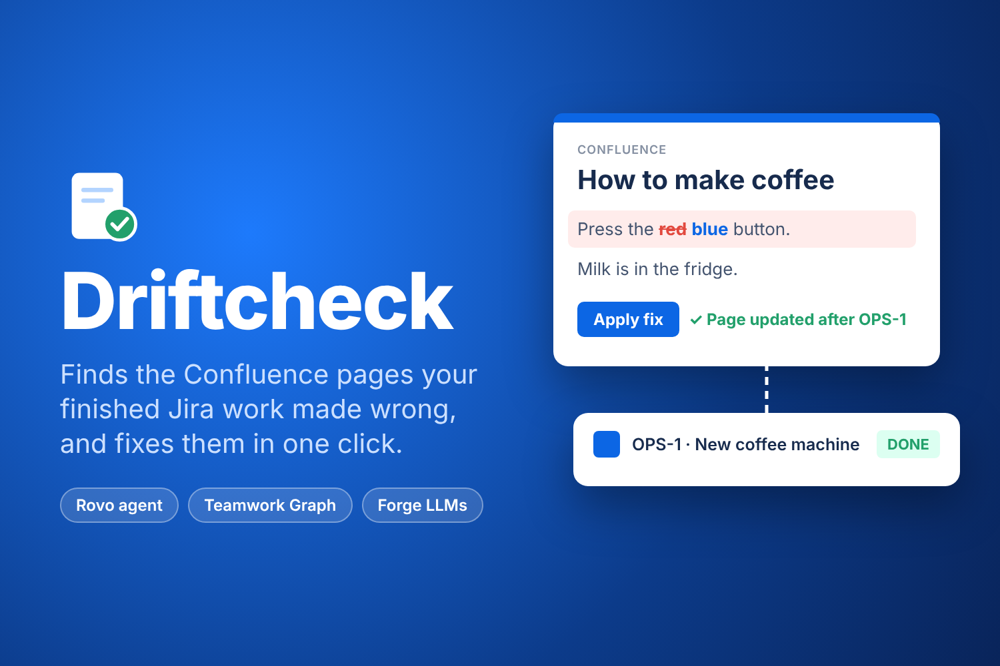
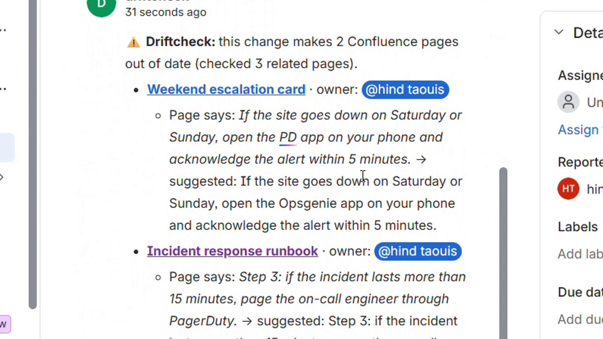
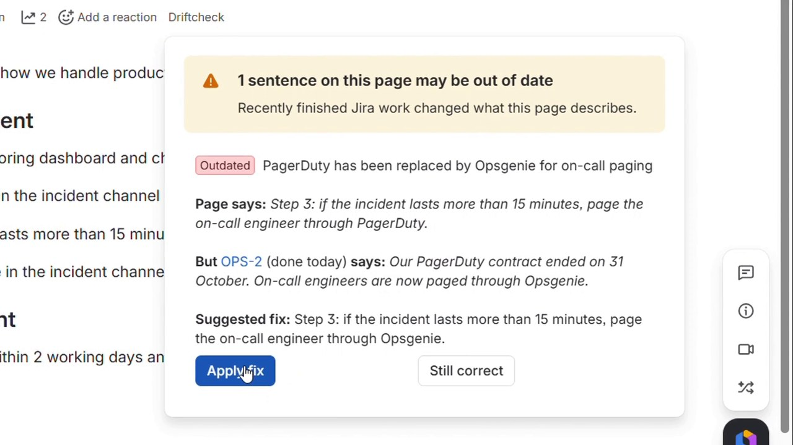
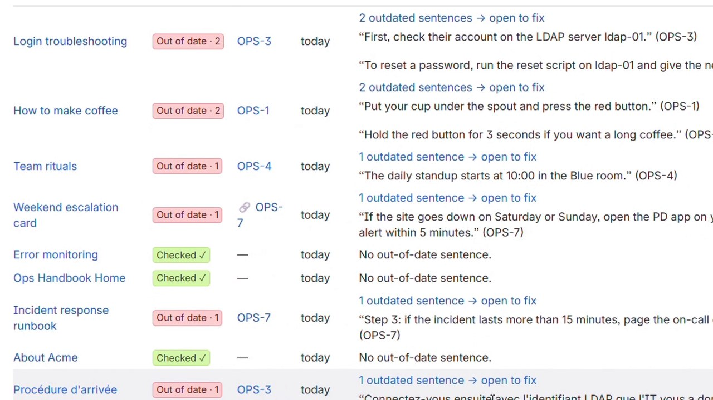
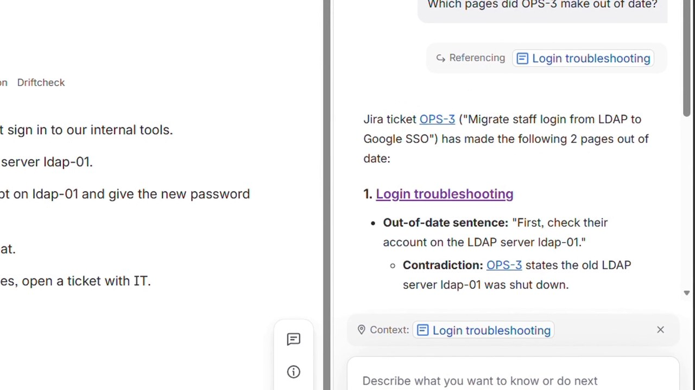

# Driftcheck



**Your Confluence pages say one thing. Your Jira work says another. Driftcheck notices, shows the proof, and fixes the page in one click.**

[▶ Demo video (2:24)](https://youtu.be/YDIstMqsTgk) · [Install Driftcheck](https://developer.atlassian.com/console/install/b41a2fa4-3cd0-46a1-913f-639fe52322ae?signature=AYABeOY%2B4PUw3Jwh3Sm5GfZgVhQAAAADAAdhd3Mta21zAEthcm46YXdzOmttczp1cy13ZXN0LTI6NzA5NTg3ODM1MjQzOmtleS83MDVlZDY3MC1mNTdjLTQxYjUtOWY5Yi1lM2YyZGNjMTQ2ZTcAuAECAQB4CxqLTo9l4lqXuFjNim1xJM%2Bp%2F3TVP9xHS2BrU5DRRucBcQDLyPNDoMEbO%2FRtMMYwdQAAAH4wfAYJKoZIhvcNAQcGoG8wbQIBADBoBgkqhkiG9w0BBwEwHgYJYIZIAWUDBAEuMBEEDB73Z3bHu0LTYEojpwIBEIA73%2Bblv6i%2BKOJaPyM%2F1hEbPTsDgN7El7e7%2Fh3Oz10A%2BH4kTrjDGQVVKjvDxcsR8XKWjdYyCmXgtsHutawAB2F3cy1rbXMAS2Fybjphd3M6a21zOmV1LXdlc3QtMTo3MDk1ODc4MzUyNDM6a2V5LzQ2MzBjZTZiLTAwYzMtNGRlMi04NzdiLTYyN2UyMDYwZTVjYwC4AQICAHi9bVMAkme4qVQX1fQHo6ePw3H40A7cGfz7yrmSfBWMXgE8%2FhY69VqgTzUTA65tXScmAAAAfjB8BgkqhkiG9w0BBwagbzBtAgEAMGgGCSqGSIb3DQEHATAeBglghkgBZQMEAS4wEQQMGCqFl7xpCNtcaoVhAgEQgDvRgHa4d4dxZx90xcR25lWmTJdJZrajAaxF36xTLf7N7UsUVP%2FOePVaQOc6lP%2Bkswn5fgZjO9Ooj%2FJgygAHYXdzLWttcwBLYXJuOmF3czprbXM6dXMtZWFzdC0xOjcwOTU4NzgzNTI0MzprZXkvNmMxMjBiYTAtNGNkNS00OTg1LWI4MmUtNDBhMDQ5NTJjYzU3ALgBAgIAeDYASx0XCjkny4iLV6vz%2BKtEGSGT6kdt0QRpkn6D%2FlVEAW2b8MwxJG1tKvtHRF6pvUQAAAB%2BMHwGCSqGSIb3DQEHBqBvMG0CAQAwaAYJKoZIhvcNAQcBMB4GCWCGSAFlAwQBLjARBAwKqFwk6%2FjvPpf372UCARCAOyzR0UM1Xchzf1GQURwfvdURgQojwIcyHqhXqPxSQ6hQpn2pjV%2F95g4vikpxLZ0OTuH4Vu5PTu7aoJp3AgAAAAAMAAAQAAAAAAAAAAAAAAAAAP3M4r%2Begr7AOH%2BtRbdyNQT%2F%2F%2F%2F%2FAAAAAQAAAAAAAAAAAAAAAQAAADIMp7Q%2BcV1nJJ2CKhaaJryDZY1WK8r%2Fk8WJPEcL5U38n6hywwmZnI9HULXNufGWXd2Em3D9loJmDC%2FcS5jmMiKBjFI%3D&product=confluence&product=jira) · [Source code](https://github.com/DarkModeGirl22/driftcheck)

## Codegeist 2026 entry

| | |
|---|---|
| **Category** | Apps for Software Teams |
| **Bonus prizes** | Best Agents (Rovo) · Best apps with Teamwork Graph integration |
| **Built on** | Forge (UI Kit, trigger, Forge LLMs, storage), Confluence, Jira, Rovo, Teamwork Graph |
| **Runs on Atlassian** | Yes: no external services, page and ticket text never leave Atlassian |

**How it fits "Build with context. Ship with confidence."** Driftcheck connects two kinds of context that live
apart: what a team *wrote down* (Confluence) and what it *actually did* (Jira work moved to Done). It uses the
Teamwork Graph to know which pages and tickets belong together, then puts the right fix in front of the right
person (the page owner) at the moment the work is finished.

**How it meets the technology requirement.** A Forge app with a manifest and 7 modules:
`confluence:contentBylineItem` (the check under every page title), `confluence:spacePage` (the space dashboard),
`trigger` on `avi:jira:updated:issue` (the automatic check when a ticket moves to Done), `rovo:agent` with two
`action` modules, `llm` (Atlassian-hosted Claude through Forge LLMs), and `function` handlers. It reads and writes
Confluence pages, reads Jira issues and posts Jira comments, and queries the Teamwork Graph API.

### Bonus prize: Best Agents (Rovo)

The **Driftcheck** Rovo agent (`rovo:agent`) has two reusable `action` modules that any agent can call as tools:
- `check-page-drift`: *"Is this page still up to date?"* returns each wrong sentence, the ticket that proves it,
  and the fix. It uses the page the person is looking at as context.
- `find-pages-for-ticket`: *"Which pages did OPS-3 make out of date?"* returns every affected page, in any
  language (the French onboarding page gets its fix written in French).

### Bonus prize: Best apps with Teamwork Graph integration

Driftcheck **consumes the Teamwork Graph API** (`requestTeamworkGraph`, persisted Cypher queries, scopes
`read:graph:page:confluence`, `read:graph:issue:jira`, `read:graph:user:atlassian`):
- `ConfluencePage -[content_entity_links_entity]-> JiraWorkItem`, in both directions: a page that links a ticket
  is checked against it **even when they share no words**. Demo: a weekend card says *"open the PD app"*; word
  search finds nothing, the graph link shows it is about the PagerDuty → Opsgenie ticket, and it gets flagged.
- The dashboard marks graph-linked pages with 🔗 and ranks them higher.
- If the graph is unavailable, Driftcheck falls back to Jira "mentioned in" links and word search: nothing breaks.

## Testing instructions (judges)

You need an Atlassian Cloud site with **Confluence and Jira** where you are an admin. The Rovo agent needs
**Rovo** enabled on the site (any Forge developer can get one free with `forge site provision`).

1. Open the **[install link](https://developer.atlassian.com/console/install/b41a2fa4-3cd0-46a1-913f-639fe52322ae?signature=AYABeOY%2B4PUw3Jwh3Sm5GfZgVhQAAAADAAdhd3Mta21zAEthcm46YXdzOmttczp1cy13ZXN0LTI6NzA5NTg3ODM1MjQzOmtleS83MDVlZDY3MC1mNTdjLTQxYjUtOWY5Yi1lM2YyZGNjMTQ2ZTcAuAECAQB4CxqLTo9l4lqXuFjNim1xJM%2Bp%2F3TVP9xHS2BrU5DRRucBcQDLyPNDoMEbO%2FRtMMYwdQAAAH4wfAYJKoZIhvcNAQcGoG8wbQIBADBoBgkqhkiG9w0BBwEwHgYJYIZIAWUDBAEuMBEEDB73Z3bHu0LTYEojpwIBEIA73%2Bblv6i%2BKOJaPyM%2F1hEbPTsDgN7El7e7%2Fh3Oz10A%2BH4kTrjDGQVVKjvDxcsR8XKWjdYyCmXgtsHutawAB2F3cy1rbXMAS2Fybjphd3M6a21zOmV1LXdlc3QtMTo3MDk1ODc4MzUyNDM6a2V5LzQ2MzBjZTZiLTAwYzMtNGRlMi04NzdiLTYyN2UyMDYwZTVjYwC4AQICAHi9bVMAkme4qVQX1fQHo6ePw3H40A7cGfz7yrmSfBWMXgE8%2FhY69VqgTzUTA65tXScmAAAAfjB8BgkqhkiG9w0BBwagbzBtAgEAMGgGCSqGSIb3DQEHATAeBglghkgBZQMEAS4wEQQMGCqFl7xpCNtcaoVhAgEQgDvRgHa4d4dxZx90xcR25lWmTJdJZrajAaxF36xTLf7N7UsUVP%2FOePVaQOc6lP%2Bkswn5fgZjO9Ooj%2FJgygAHYXdzLWttcwBLYXJuOmF3czprbXM6dXMtZWFzdC0xOjcwOTU4NzgzNTI0MzprZXkvNmMxMjBiYTAtNGNkNS00OTg1LWI4MmUtNDBhMDQ5NTJjYzU3ALgBAgIAeDYASx0XCjkny4iLV6vz%2BKtEGSGT6kdt0QRpkn6D%2FlVEAW2b8MwxJG1tKvtHRF6pvUQAAAB%2BMHwGCSqGSIb3DQEHBqBvMG0CAQAwaAYJKoZIhvcNAQcBMB4GCWCGSAFlAwQBLjARBAwKqFwk6%2FjvPpf372UCARCAOyzR0UM1Xchzf1GQURwfvdURgQojwIcyHqhXqPxSQ6hQpn2pjV%2F95g4vikpxLZ0OTuH4Vu5PTu7aoJp3AgAAAAAMAAAQAAAAAAAAAAAAAAAAAP3M4r%2Begr7AOH%2BtRbdyNQT%2F%2F%2F%2F%2FAAAAAQAAAAAAAAAAAAAAAQAAADIMp7Q%2BcV1nJJ2CKhaaJryDZY1WK8r%2Fk8WJPEcL5U38n6hywwmZnI9HULXNufGWXd2Em3D9loJmDC%2FcS5jmMiKBjFI%3D&product=confluence&product=jira)** and install Driftcheck on your site for **Confluence and Jira**.
   Accept the permissions (Confluence pages, Jira issues, Teamwork Graph, app storage).
2. In Confluence, create a page *"How to make coffee"* with the sentence *"Put your cup under the spout and press
   the red button."*
3. In Jira, create a ticket *"Replace the coffee machine"* with the description *"The new machine has a single
   blue start button."* Move it to **Done**.
4. **Automatic check:** within about 20 seconds, Driftcheck comments on the ticket with the page it made wrong and
   tags the page owner. Reload the ticket to see it.
5. **On the page:** click **Driftcheck** under the title. You see the wrong sentence, the proof quoted from the
   ticket, and a suggested fix. Click **Apply fix**: the page is updated and its history says
   "Driftcheck: updated after <ticket>". **Still correct** dismisses a warning for good.
6. **Dashboard:** in the space sidebar, click **Driftcheck**, then **Check with AI** on any page.
7. **Rovo:** click **Ask Rovo**, open the agent menu (**Rovo ⌄**), search *"Drift"*, pick **Driftcheck**, and ask
   *"Is this page still up to date?"* or *"Which pages did <ticket> make out of date?"*
8. **Try to trick it:** add a comment on a ticket saying the change was rolled back, or write a page that is old
   but still true (*"Founded in 2010"*). Driftcheck leaves them alone.

Notes: only tickets moved to Done in the last 30 days are considered. New pages and links can take a minute to
appear in Confluence search and the Teamwork Graph.

## Screenshots

| | |
|---|---|
|  **Automatic check:** the comment on the finished ticket, page owners tagged |  **On the page:** wrong sentence, proof, fix, Apply fix |
|  **Space dashboard:** out of date vs. checked |  **Rovo agent:** which pages did a ticket make wrong |

## The problem

Every team's wiki goes stale silently. A runbook still describes a server that was removed.
An onboarding guide points to a tool nobody uses anymore. Nothing turns red when that happens,
so people follow wrong instructions, and now AI assistants like Rovo repeat them with confidence.

Existing tools look at a page's **age**. But age is a bad clue:

- "Our company was founded in 2010" hasn't been edited in five years, and it's still true.
- "Press the red button on the coffee machine" was edited last week for a typo, and it's wrong,
  because the machine was replaced in ticket KAN-1.

## What Driftcheck does

Driftcheck reads the **work that actually happened** (Jira tickets moved to Done) and checks it
against what the **documentation says**. When a finished ticket contradicts a sentence, it shows:

> **Page says:** 2. Press the red button and wait 30 seconds.
> **But KAN-1 (done 2 days ago) says:** The old red button no longer exists.
> **Suggested fix:** 2. Press the blue start button and wait 30 seconds.
> [Apply fix] [Still correct]

Pages that are old but still true are left alone.

## Features

| Where | What |
|---|---|
| **Under every page title** | "Driftcheck" opens the check for that page: each out-of-date sentence, the ticket that proves it, and a suggested rewrite. |
| **Apply fix** | Rewrites the sentence in one click and records "Driftcheck: updated after KAN-1" in the page history. |
| **Still correct** | Dismisses a warning for good (stored on the page itself), so Driftcheck never cries wolf twice. |
| **Space dashboard** | Every page of the space with its status: **Out of date** (with the sentences), **Checked ✓**, or **Not checked** ranked by a quick guess, with a "Check with AI" button. Saved AI verdicts show instantly, at no AI cost. |
| **Automatic check on Done** | Move a Jira ticket to Done and Driftcheck comments on it: *"⚠️ this change makes 2 Confluence pages out of date"*, quoting each wrong sentence and its fix, and **@mentions each page's owner** so the right person is notified. Silent when nothing is affected. |
| **Knows what's linked** | A page that links to a ticket is checked against it even when they share no words (*"open the PD app"* on a page linking the PagerDuty → Opsgenie ticket). Uses the **Teamwork Graph** and Jira's "mentioned in" links. Linked pages get a 🔗 on the dashboard. |
| **Rovo agent** | Ask in chat: *"Is this page still up to date?"* or *"Which pages did KAN-1 make out of date?"* |

## How it works

1. **Read:** the page (Confluence REST v2) and Jira tickets that moved to Done in the last 30 days
   (JQL on `statusCategoryChangedDate`, which works even in simple Kanban projects), including
   each ticket's last comments, where decisions often live.
2. **Narrow down:** keep tickets the page links to (Teamwork Graph: `ConfluencePage
   -[content_entity_links_entity]-> JiraWorkItem`) plus tickets that share meaningful words with the
   page, so the AI only sees relevant work (cheaper, faster, fewer false alarms).
3. **Judge:** Claude Sonnet 4.6 via the **Forge LLMs API** decides, sentence by sentence, whether a
   ticket makes it untrue. Long pages are split into parts checked in parallel. The AI must quote the
   page and the ticket exactly; quotes that aren't really on the page are thrown away, and unsure
   findings are dropped, so it doesn't cry wolf.
4. **Remember:** results are saved on the page, so the AI only runs again when the page or its
   related tickets change (faster, cheaper).
5. **Act:** the user applies the fix or dismisses it. Every change is visible in the page history.
   Apply fix works through bold text, links, tables and accented characters, and refuses to touch
   anything ambiguous.

## Does it actually work? (measured, failures included)

We tested Driftcheck in a real Confluence + Jira site, through the app itself (no mocks):
**49 test pages and 41 finished Jira tickets**, in three rounds. Each round was built to break it.

### Round 1: the basics (18 pages)

Plain drift, a drift hidden at the bottom of a 14,000-character page, a decision written only in a
ticket **comment**, sentences inside **tables** and in **bold**, French pages, old-but-true pages,
general rules that survive a change. The first version scored **14/18**. The misses led to reading
ticket comments, checking long pages in parts, and a stricter definition of "out of date". After
that: **18/18**, plus the "no shared words, but the page links the ticket" case (**19/19**).

### Round 2: traps (16 pages, 24 sentences)

| Trap | Example | Result |
|---|---|---|
| Change **rolled back** in a comment | "Errors are reported to Sentry" (move to Datadog, then rolled back) | ✅ not flagged |
| **Spike** that decided to change nothing | "Team chat happens in Slack" | ✅ not flagged |
| **Other instance** of the same thing | Lyon printer moved, Paris printer didn't | ✅ only Lyon flagged |
| New **option added**, old one still works | Apple Pay added, "customers pay by card" | ✅ not flagged |
| Page **already up to date** | "Mockups are made in Figma" | ✅ not flagged |
| Same word, **different meaning** | "Release notes…" vs. the "Release" button moved | ✅ not flagged |
| Different **units / wording** | "three months" vs. "90 → 30 days" | ✅ flagged, fix says 30 days |
| **Abbreviation** | "e-sign with **DS**" vs. DocuSign → Yousign | ✅ flagged |
| Changed **twice** | demo Tuesday → Wednesday → Thursday | ✅ fix says **Thursday** |
| Server **deleted**, no replacement given | "run it on staging-2 first" | ✅ flagged |

**What failed in round 2 (10/11 caught, 1 false alarm):**
1. ❌ A **history** sentence ("in 2025 we moved our status page from Statuspage to Instatus") was flagged.
   It is still true.
2. ❌ A **French page vs. an English ticket** with no shared words was missed: word matching never
   showed that ticket to the AI.
3. ❌ The automatic Jira comment flagged "write what you see in **the incident channel**" after the
   channel was renamed. It doesn't name the old channel, so it is still true.
4. ⚠️ One page sometimes failed with "AI couldn't run" (the AI's answer wasn't always clean JSON).

**How we fixed it:**
- Clearer rules for the AI: history, general wording and a *different* office, region or meeting are not drift.
- **AI triage:** tickets that share no words with the page are now sorted by meaning (other language,
  abbreviation, synonym), so the AI can still pick the right ones.
- A tolerant JSON reader, one automatic retry, and a guard that drops a "fix" identical to the sentence.

### Round 3: unseen cases, written *after* the fixes (14 pages, 17 sentences)

To avoid grading our own homework, round 3 was written after the fixes, with new traps:
a change **cancelled after legal review**, a **plan** for next March ("nothing changes before then"),
an IT contact changed **twice** (Tom → Ana → Leo), a **French page / English ticket** with no shared words,
an office that **closed**, a free-shipping threshold that changed for **France only**, and history next to
a current fact ("We adopted Pipedrive in 2022" / "Log every call in Pipedrive").

### Final run (rounds 2 and 3, current version)

| | Result |
|---|---|
| Out-of-date sentences caught | **20 / 20** |
| Suggested fixes that are correct | **20 / 20** (Leo, not Ana; French fix written in French; Belgium kept at 50€) |
| True sentences wrongly flagged | **1 / 21** |

The one remaining false alarm, so you know where it can still be wrong: "You can work remotely on Mondays",
after Fridays were **added**. The AI reasoned the sentence implies Mondays are the only day. A grey area, but we
count it as wrong.

**One more fix after the first final run (2 → 1 false alarm).** The first final run had a second false alarm
("…file it in **the CRM**", flagged for the CRM switch), and on our big demo site the automatic check flagged
"Critical errors also trigger an on-call page" after the paging tool changed. Both sentences were still true.
Fix: the AI must now quote the **exact words in the sentence that are false today** (for example "PagerDuty",
"Tuesday", "three months"), and Driftcheck checks that those words really are in the sentence. A sentence that
is only incomplete is not out of date. Re-running everything on that version: 20/20 caught, 20/20 correct fixes,
1/21 false alarms.

Every result was produced by the deployed app; the test pages and tickets are in our test site.

## Built with

- Forge UI Kit: `confluence:contentBylineItem`, `confluence:spacePage`
- Forge LLMs API (`@forge/llm`): Atlassian-hosted Claude, no external API keys,
  data never leaves Atlassian. The app is eligible for **Runs on Atlassian**.
- Rovo: `rovo:agent` with two `action` modules (`check-page-drift`, `find-pages-for-ticket`)
- Forge `trigger` on `avi:jira:updated:issue` for the automatic check, with Forge storage for
  safety limits (each move to Done checked once, at most 20 automatic checks per day)
- **Teamwork Graph** (`requestTeamworkGraph`, persisted Cypher queries) to find which pages and
  tickets link to each other, with Jira remote links as a fallback for the automatic check
- Confluence and Jira REST APIs, called as the current user, so permissions are always respected

## Privacy and safety

- Runs entirely on Atlassian infrastructure (Forge functions + Forge LLMs). No egress.
- All reads and writes happen **as the user**: Driftcheck can only see or edit what that user can.
- Nothing is changed without a click. "Apply fix" creates a normal page version you can roll back.

## Install and run (developers)

```bash
npm install
forge deploy
forge install --product confluence --site <your-site>.atlassian.net
forge install --product jira --site <your-site>.atlassian.net
```

Note: the Teamwork Graph queries Driftcheck uses are registered for our app ID. If you deploy your own
copy (a new app ID), Driftcheck still works: it falls back to Jira "mentioned in" links and word search.

Open any Confluence page and click **Driftcheck** under the title. To try it, create a page that
says "Press the red button", then a Jira ticket saying the red button was replaced, and move it to Done.

## Big sites

On a real company site (our demo site has hundreds of sample pages), a plain word search returns noise:
"engineers" or "October" are on half the pages. For the automatic check, Driftcheck runs one search per
main word of the ticket to collect candidates, then the AI picks the pages that are really about what
the ticket changed. Driftcheck also ignores its own Jira comments when it reads a ticket.

## What's next

- Known limit: the automatic check on Done finds pages by search, so a page in another language that
  doesn't link the ticket can be missed there (the page check itself handles it via AI triage).

- Check code changes too (Bitbucket pull requests), not only Jira tickets.
- Notify the page owner directly, not only the ticket.
